## About

I'm **Steven / @steventeng2022**, currently studying at **High School**. I build web applications, automation tools, and mobile projects, with hands-on experience in **system design, deployment, and maintenance**.

My interests span **software engineering, artificial intelligence, and cybersecurity**. I enjoy turning everyday needs into working systems, learning through research and collaboration, and creating videos along the way. I hope to study computer science, AI, and information security more deeply at university.

- 🌐 **Web & systems:** full-stack applications, cloud deployment, and service maintenance.
- 🤖 **AI & research:** model behavior, experimental design, and statistical hypothesis testing.
- 🔐 **Cybersecurity:** learning through competition preparation and hands-on practice.
- 🤝 **Collaboration:** shared projects, hackathons, and tools that help real communities.

<b>中文簡介</b>

我目前就讀臺北市高中，具備系統設計、部署與維護經驗。個人開發 Steven Personal Website 與社群小幫手，並共同參與 itouOJ Online Judge、YetAnotherBusApp。

研究方面，我以 MNIST 與 MLP 探討隨機影像雜訊對模型輸出的影響，接觸實驗設計與統計檢定。曾參與 Futuremode Hackathon、SITCON Hackathon，目前準備資安相關競賽，持續學習 Web Security、Reverse Engineering、Pwn、Cryptography 與 Forensics。未來希望在大學深入資訊工程、人工智慧與資訊安全。

> Keep learning. Keep building. Keep creating.

## Now

- 🛡️ Preparing for **資安全相關競賽**, focusing on Web Security, Reverse Engineering, Pwn, Cryptography, and Forensics.
- 🧩 Practicing C++ and working through [TOI problems](https://github.com/steventeng2022/coding-practice).
- 🧠 Studying machine learning, model behavior, and how to design and evaluate experiments.
- 🛠️ Continuing to build and maintain useful applications, including [my personal website](https://steventeng.uk/).

## Featured Projects

| Project | My role & contribution | Stack |
| --- | --- | --- |
| [Steven Personal Website](https://github.com/steventeng2022/website1) · [Live](https://steventeng.uk/) | **Personal project.** Designed, deployed, and maintained a portfolio, Blog, admin dashboard, and website analytics. | Next.js, React, TypeScript, Cloudflare Workers, D1, R2 |
| [社群小幫手 — Community Assistant](https://github.com/steventeng2022/116-linebot) | **Personal project.** Automated attendance responses, event task assignments, and public-service hour records for a community team. | Python, FastAPI, LINE Messaging API |
| [itouOJ Online Judge](https://github.com/itousouta15/itouOJ) | **Co-developer.** Participated in submission workflows, real-time judging, contests, and multi-language execution environments. | Next.js, TypeScript, Linux, multi-language runtimes |
| [YetAnotherBusApp](https://github.com/YetAnotherBusDeveloper/yetanotherbusapp) | **Contributor.** Participated in a cross-platform bus application integrating TDX transport data. | Flutter, Dart, TDX API |

## Research & Experiments

- **MNIST × MLP × image noise:** explored how random image noise affects model outputs, gaining experience in experimental design and statistical hypothesis testing.
- **[AI notebooks & experiments](https://github.com/steventeng2022/ml-colab-1):** hands-on Python work with PyTorch, scikit-learn, data analysis, and model evaluation.
- **[NFL Big Data Bowl 2027](https://github.com/steventeng2022/Kaggle-NFL-Big-Data-Bowl-2027):** a reproducible notebook studying receiver speed and NFL route movement.

## Hackathons & Security Learning

**Participated in:** multiple hackathons
**Preparing for:** CTF

My current security learning areas are **Web Security**, **Reverse Engineering**, **Pwn**, **Cryptography**, and **Forensics**.

## Tech Toolbox

### Web & Cloud

Portfolio and Blog development · Admin interfaces · **Cloudflare Workers / D1 / R2**

### Backend & Mobile

API integration · Workflow automation · **LINE Messaging API / TDX API**

### AI, Systems & Development Tools

**NumPy / pandas / Matplotlib** · Python notebooks · Model evaluation · Deployment and maintenance

## Activity

<picture>
  <source media="(prefers-color-scheme: dark)" srcset="https://raw.githubusercontent.com/steventeng2022/steventeng2022/output/snake-dark.svg">
  <source media="(prefers-color-scheme: light)" srcset="https://raw.githubusercontent.com/steventeng2022/steventeng2022/output/snake-light.svg">
  
</picture>

  

<b>My contributions in 3D</b>

 
<picture>
  <source media="(prefers-color-scheme: dark)" srcset="https://raw.githubusercontent.com/steventeng2022/steventeng2022/output/contrib-3d-dark.svg">
  <source media="(prefers-color-scheme: light)" srcset="https://raw.githubusercontent.com/steventeng2022/steventeng2022/output/contrib-3d-light.svg">
  
</picture>

---

Open to collaborating on web applications, community tools, AI experiments, cybersecurity learning, and video projects.  
Contact: [steventeng2022@gmail.com](mailto:steventeng2022@gmail.com)

<!-- Original blue terminal artwork in assets/.
     Layout inspiration: https://github.com/Sean-Hawks
     The existing toolbox, snake and Nord trophies are retained.
     Graphics refresh daily through .github/workflows/profile-graphics.yml.
     Snake: https://github.com/Platane/snk
     3D graph: https://github.com/yoshi389111/github-profile-3d-contrib
     Toolbox: https://skillicons.dev
     Trophy cards use public statistics and decorative milestone ranks.
     Commits/reviews cover the past year; experience points equal 100-day periods.
     Rank thresholds are inspired by https://github.com/ryo-ma/github-profile-trophy
     with customized language milestones. -->
